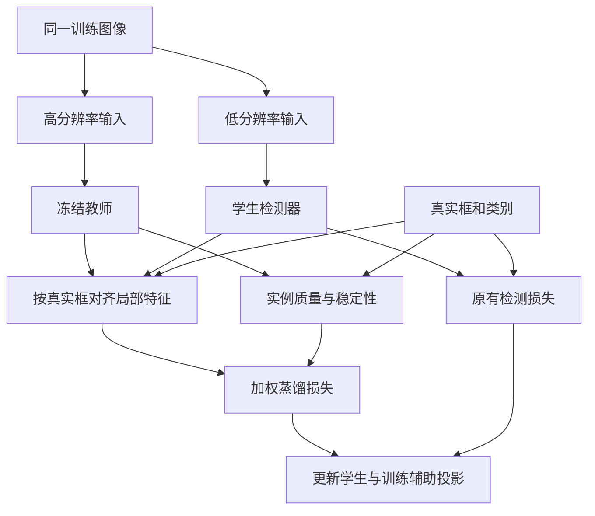

# CRIR-KD

**面向微小目标检测的跨分辨率实例可靠性引导知识蒸馏**\
Cross-Resolution Instance-Reliability-Guided Knowledge Distillation for Tiny Object Detection

> **当前状态：研究规划与基础工具原型。** 本仓库提供课题说明、技术路线、实验协议、开发清单，以及可运行的数据检查、几何和可靠性参考工具。尚未实现完整 YOLO 蒸馏训练流程，尚无训练权重、实测精度或论文录用结果。CRIR-KD 是暂定项目简称。

## 这个项目研究什么

希望在保持学生检测器结构和测试输入尺寸不变的条件下，通过改进训练方法，提高微小目标检测能力。

训练时，较高分辨率的教师模型为较低分辨率的学生模型提供额外信息。拟研究的问题是：**教师对不同目标的指导并不总是同样可靠，按实例评估和使用这些指导，是否比统一蒸馏或简单质量加权更有效？**

最终使用时仅运行学生检测器，输出目标框、类别和预测分数。教师及蒸馏辅助部件仅在训练中使用，因此训练成本会增加；部署成本是否保持接近基线需要实测。

## 已完成与未完成

| 内容 | 状态 |
| --- | --- |
| 研究问题与术语说明 | 已整理 |
| 数据集、基线和实验协议 | 已规划 |
| YOLO 版本和运行环境 | 待确定 |
| 数据集下载与官方规则适配 | 待实现 |
| 合成数据基础工具与格式审计 | 已实现原型，见下方运行方式 |
| 教师和学生基线训练 | 待运行 |
| 跨分辨率特征对齐 | 待实现 |
| 实例质量、稳定性和加权蒸馏 | 待实现与验证 |
| 消融、重复实验和性能报告 | 待完成 |

**目前没有可执行的完整训练入口。** `configs/study.example.yaml` 只记录候选研究设置，不是可以直接交给 YOLO 运行的配置。

基础工具使用 Python 3.10+ 标准库，可在仓库根目录运行 `python -m crir_kd demo` 查看明确标注的合成演示，运行 `python -m unittest discover -s tests -v` 验证。数据审计、公式定义、输入格式与限制见 [基础工具说明](docs/prototype-tools.md)。这些工具不构成已完成的检测训练系统。

## 初始技术路线

1. 在公开训练集上训练教师，验证它在微小目标上确实优于学生基线。
2. 蒸馏阶段冻结教师。对同一训练图像生成教师高分辨率输入和学生低分辨率输入。
3. 用同一真实框建立实例对应，正确处理缩放、补边和特征层坐标，提取可比较的局部特征。
4. 根据教师相对真实标注的质量，以及轻微扰动后的预测稳定性，估计实例指导权重。
5. 保留所有真实目标的正常检测监督，仅调整额外蒸馏的影响。
6. 在固定学生结构和输入尺寸下，与普通训练、普通蒸馏和简单加权方法比较。

## 阅读顺序

- [术语与入门说明](docs/glossary.md)：教师、学生、实例、特征和蒸馏对象分别是什么。
- [研究计划](docs/research-plan.md)：研究假设、拟采用的方法、阶段安排和失败判据。
- [实验协议](docs/experiment-protocol.md)：数据划分、对照实验、指标和实验记录要求。
- [相关论文与官方资源](docs/references.md)：查重和复现入口。
- [开发路线图](ROADMAP.md)：按依赖关系推进实现。
- [配置说明](configs/README.md)：候选配置与可运行训练配置的区别。

## 数据与结果

优先考虑 VisDrone-DET 和 AI-TOD-v2，遵守各数据集的使用条件和官方评价协议。数据下载和准备流程尚未接入。

仓库不包含数据集、第三方论文全文、模型权重或训练输出。模型结果只有在实验实际完成后，才应附带对应配置、代码版本、数据划分和原始日志进行记录。

目前没有实测结果，不预设或承诺精度提升，也不宣称现有方案已经具备经验证的新颖性。

## 研究边界

- 教师预测错误不意味着需要重新标注；优先使用现有真实标注评价教师指导。
- 稳定不等于正确，高置信度不等于准确，教师准确也不等于学生一定能够学会。
- 低权重目标仍参与正常检测监督，不能通过忽略最小目标来提高总体指标。
- 跨分辨率蒸馏、特征对齐和扰动可靠性均有先例，必须与相关工作正面对比。
- 本项目属于目标检测训练方法研究；此 GitHub 仓库用于版本管理与协作，不是在线 GPU 训练服务。

## 许可与第三方依赖

项目尚未指定开源许可证。引用和后续使用第三方代码、模型或数据时，必须分别遵守其许可证及使用条件。本仓库包含研究文档、配置草案与原创基础工具，未复制第三方模型实现。
